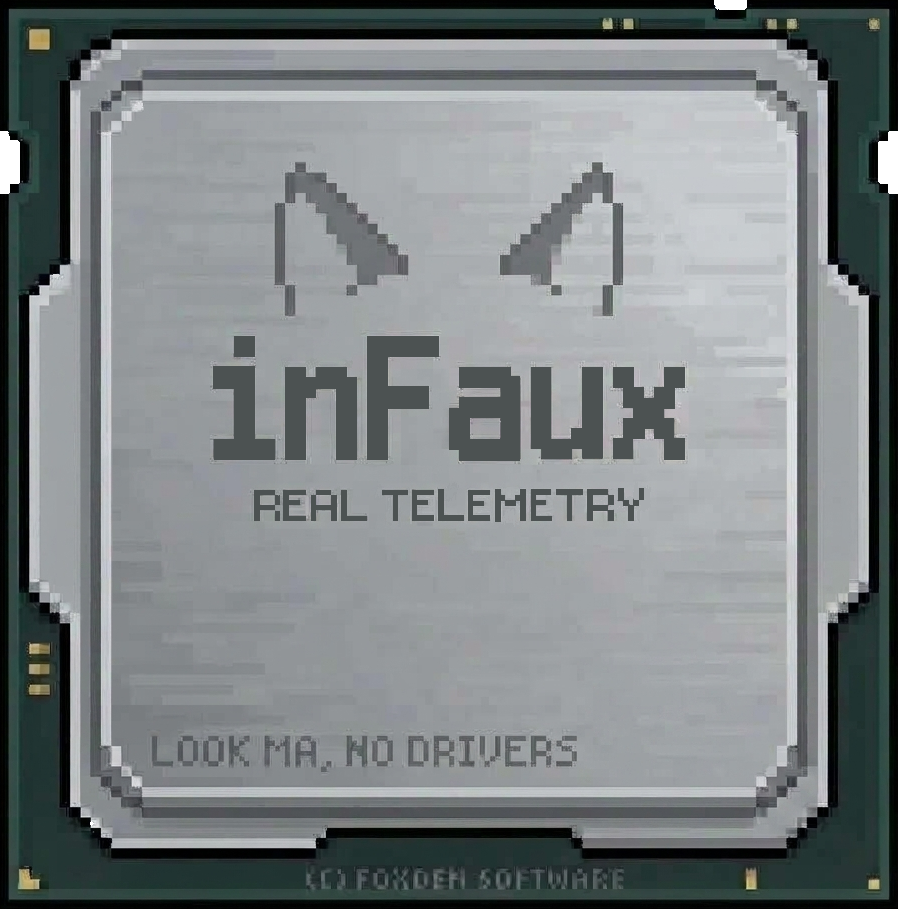
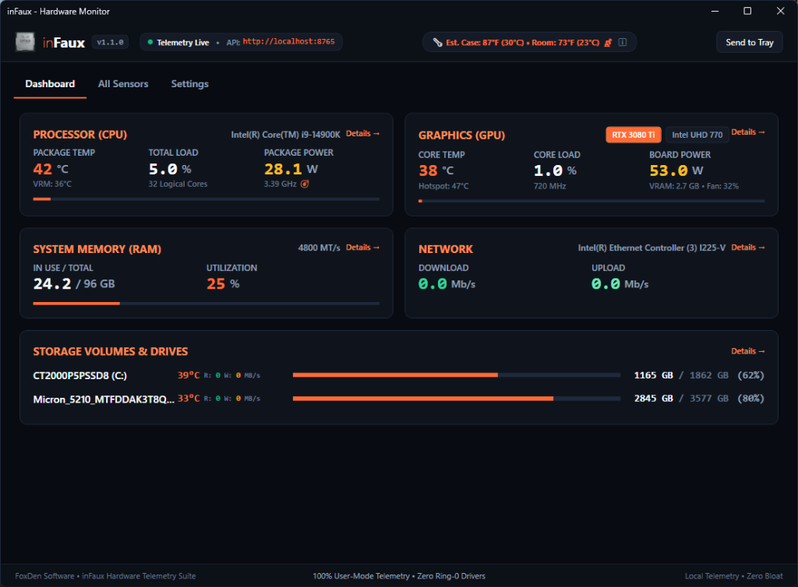
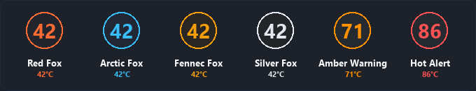
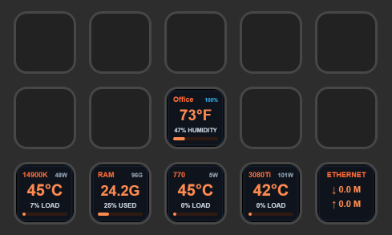

<p align="center">
  
</p>

<h1 align="center">inFaux</h1>

<p align="center">
  <em>The Modern, Native Hardware Monitor &amp; Open Telemetry Server for Windows</em><br>
  <em>Real telemetry. Faux drivers. Colloquially known as "info".</em><br>
  <em>Crafted with care by FoxDen Software</em>
</p>

<p align="center">
  <a href="https://github.com/TalviFox/inFaux"></a>
  <a href="https://dotnet.microsoft.com/"></a>
  <a href="https://github.com/TalviFox/inFaux"></a>
  <a href="https://github.com/TalviFox/inFaux"></a>
  <a href="https://github.com/TalviFox/inFaux"></a>
  <a href="https://github.com/TalviFox/inFaux/releases"></a>
  <a href="LICENSE"></a>
  <a href="https://ko-fi.com/foxdensoftware"></a>
</p>

> *"Microsoft basically went 'we can't agree what temp is correct, so you can have none without kernel drivers' unless you do this complicated-ass math."*

---

## ⚡ TL;DR

* **What it is:** A fast, single-file Windows hardware monitor that lives in your system tray and serves a clean local telemetry API.
* **Why it exists:** Most PC monitoring tools force a terrible tradeoff - either sketchy 1990s kernel drivers (`WinRing0.sys`) that trip Windows Defender Core Isolation, or 800 MB corporate bloatware with accounts, stores, and background daemons. 
* **The inFaux way:** Runs 100% in user space (`asInvoker`), requires **zero administrator rights**, and estimates CPU thermals using real Newtonian physics anchored to physical SSD & GPU diodes instead of vulnerable kernel hooks.
* **Extras:** Built-in Stream Deck companion, dynamic numeric taskbar tray icon, passive Bluetooth room/case thermometers (BTHome v2), and a local REST/WebSocket server for custom dashboards.

<p align="center">
  
</p>

---

## 🚀 Quick Install & Downloads

### Option 1: One-Line PowerShell Install
Run in any standard **(non-elevated)** PowerShell terminal:

```powershell
irm https://raw.githubusercontent.com/TalviFox/inFaux/main/install.ps1 | iex
```

> [!NOTE]
> **No Admin Privileges Needed:** inFaux is 100% zero-driver and designed to run safely with standard user permissions (`asInvoker`). Do not run the installer as Administrator!

### Option 2: Standalone Portable Binary
Prefer a standalone portable executable? Grab `inFaux.exe` directly:

* 📦 **[Download Latest inFaux Release](https://github.com/TalviFox/inFaux/releases/latest)**
* 🗂️ **[View All Releases & Changelogs](https://github.com/TalviFox/inFaux/releases)**
* 🌐 **[Official Website & Web Documentation](https://infaux.foxdensoftware.dev/)**

---

## ✨ Features at a Glance

* 🛡️ **100% Driverless & Zero-UAC:** Zero kernel drivers (`.sys`), zero background services, zero elevation prompts. Fully compatible with Windows 11 Core Isolation, Memory Integrity (HVCI), and Defender.
* 🌡️ **Thermodynamic Observer:** Real physics instead of driver exploits. Models processor thermal mass, Joule heating, and per-core thermal flux, anchored directly to physical NVMe SMART diodes and liquid cooler loops.
* 📡 **Passive Bluetooth Telemetry (BTHome v2):** Listens passively for open BLE environmental beacons (Shelly BLU H&T, ESPHome, ThermoBeacon) to track ambient room, case, and radiator exhaust temps with zero USB dongles.
* 🎮 **Stream Deck Companion:** Live hardware gauges on your desk with 1-click in-app installation, custom key renaming, and tap-to-cycle metrics.
* 🔢 **Dynamic Numeric System Tray Icon:** Renders live, high-legibility temperature numbers right onto your Windows taskbar, with automatic safety color escalation (amber/red).
* 🎨 **Fox Coat Theme Engine:** 6 curated themes: Silver Fox, Silver Fox OLED (True Black), Red Fox Ember, Arctic Fox Cyan, Arctic Fox Snow White, and Fennec Fox Amber.
* 🔌 **Embedded Local API:** Built-in REST and WebSocket server on `http://127.0.0.1:8765` for Stream Deck, Rainmeter, Home Assistant, and custom dashboards.

---

## 📸 Visual Showcase

### System Tray & Stream Deck Integration

<p align="center">
  
</p>

<p align="center">
  
</p>

---

## 📖 Detailed Technical Specification

Looking for the complete architectural breakdown, thermodynamic formulas, API schemas, or configuration tables? Everything is documented in depth:

👉 **[Read the Full Technical Specification (SPEC.md)](SPEC.md)**

* **[Physics & Thermodynamics](SPEC.md#2-the-thermodynamic-observer):** Newton's law of cooling, IIR filter constants, storage diode anchoring, and cold plate modeling.
* **[Hardware Harvesters](SPEC.md#3-hardware-harvesters--subsystems):** NVML, AMD ADL, DXGI COM interop, SMART IOCTLs, and BTHome v2 BLE packet decoding.
* **[Local API Reference](SPEC.md#6-embedded-local-api-reference):** Endpoint catalogue, curated snapshot schemas (`GET /api/v1/summary`), and WebSocket stream protocol.
* **[Configuration Reference](SPEC.md#7-configuration-reference):** Complete `%LOCALAPPDATA%\inFaux\config.json` options.

---

## 🛠️ Building from Source

### Prerequisites
* Windows 10 (Build 19041+) or Windows 11
* [.NET 10.0 SDK](https://dotnet.microsoft.com/)

```powershell
# Clone and build
git clone https://github.com/TalviFox/inFaux.git
cd inFaux
dotnet build -c Release

# Or publish a standalone single-file binary:
dotnet publish InFox.csproj -c Release -r win-x64 --self-contained true -p:PublishSingleFile=true -o publish
```

---

## 💡 Transparency & AI Disclosure

inFaux is developed with the assistance of AI coding tools. In the spirit of open development and personal accountability: **I don't post what I don't run.**

Every feature, script, and build is actively dogfooded, tested, and run on my daily-driver machines before it is published.

---

## ☕ Support the Project

inFaux is free, source-available, and 100% independent software. If inFaux saves you from bloated, driver-heavy monitoring utilities and you want to support continued development:

<p align="center">
  <a href="https://ko-fi.com/foxdensoftware">
    
  </a>
</p>

Every cup of coffee helps keep the project fast, driverless, and actively maintained!

---

## 🦊 FoxDen Software Suite

* **[inFaux](https://infaux.foxdensoftware.dev/)**: Modern, Native Hardware Monitor & Telemetry Server for Windows
* **[WireFox](https://wirefox.foxdensoftware.dev/)**: Intelligent WireGuard Roaming Companion for Windows

<p align="center">
  <a href="https://foxdensoftware.dev/">
    
  </a><br>
  <sub><em>Crafted with care by <strong>FoxDen Software</strong></em></sub>
</p>

---

*Copyright © FoxDen Software. Distributed under the PolyForm Noncommercial License 1.0.0.*  
*Elgato and Stream Deck are registered trademarks of Corsair Memory, Inc. inFaux is an independent open-source project and is not affiliated with, endorsed by, or sponsored by Corsair or Elgato.*
