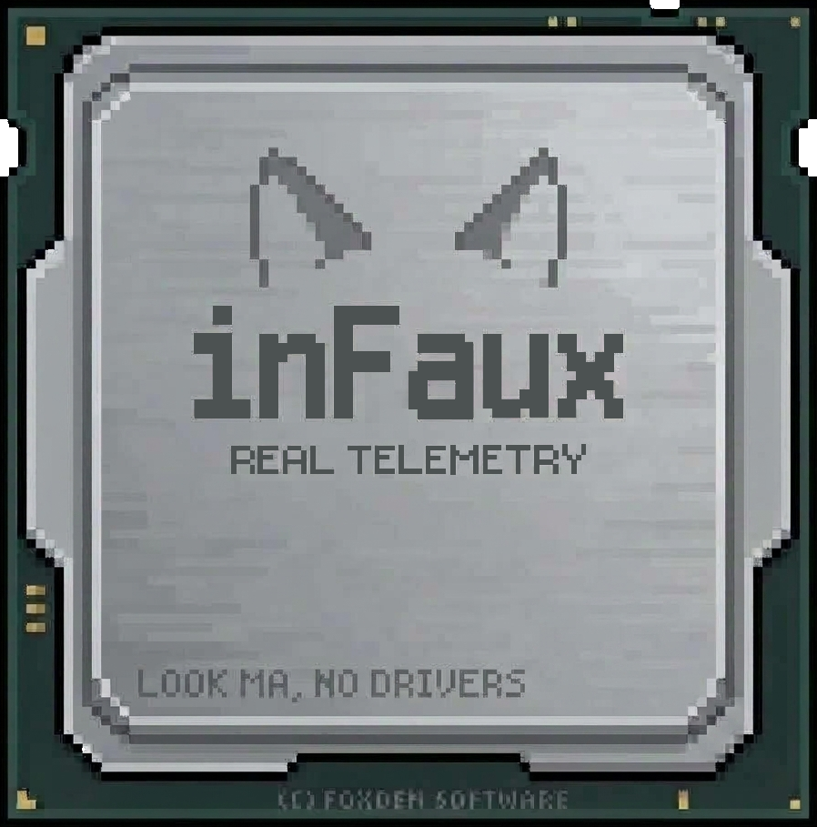
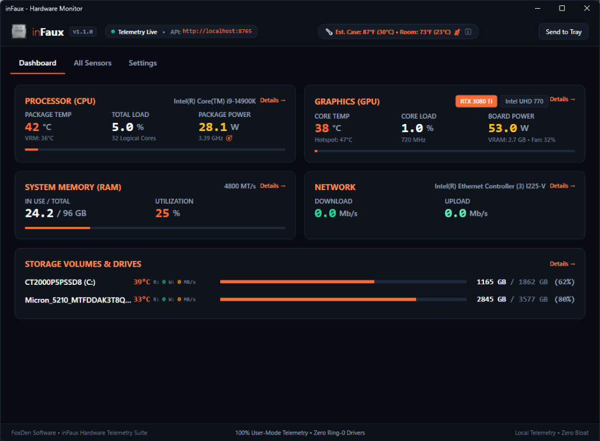
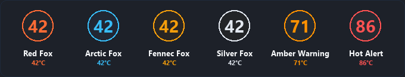
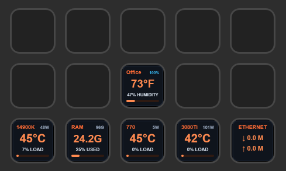

<p align="center">
  
</p>

<h1 align="center">inFaux</h1>

<p align="center">
  <em>The Modern, Native Hardware Monitor &amp; Open Telemetry Server for Windows</em><br>
  <em>Real telemetry. Faux drivers. Colloquially known as "info".</em><br>
  <em>Crafted with care by FoxDen Software</em>
</p>

<p align="center">
  <a href="https://github.com/TalviFox/inFaux"></a>
  <a href="https://dotnet.microsoft.com/"></a>
  <a href="https://github.com/TalviFox/inFaux"></a>
  <a href="https://github.com/TalviFox/inFaux"></a>
  <a href="https://github.com/TalviFox/inFaux"></a>
  <a href="LICENSE"></a>
</p>

> *"Microsoft basically went 'we can't agree what temp is correct, so you can have none without kernel drivers' unless you do this complicated-ass math."*

---

## ⚡ TL;DR

Most PC hardware monitors force an ugly tradeoff: either sketchy 1990s kernel drivers (`WinRing0.sys`) that trigger Windows Defender Core Isolation, or 800 MB vendor bloatware packed with accounts, stores, and background daemons.

inFaux lives in your system tray as a fast, single-file utility running completely in user space (`asInvoker`) with zero administrator rights. It estimates CPU thermals using Newtonian physics anchored to physical NVMe SSD and GPU diodes instead of vulnerable kernel hooks, and serves clean local telemetry via REST and WebSocket alongside Stream Deck and Bluetooth sensor support.

<p align="center">
  
</p>

---

## 🚀 Quick Install

Run in any standard **(non-elevated)** PowerShell terminal:

```powershell
irm https://raw.githubusercontent.com/TalviFox/inFaux/main/install.ps1 | iex
```

> [!NOTE]
> **No Admin Privileges Needed:** inFaux is 100% zero-driver and designed to run safely with standard user permissions (`asInvoker`). Do not run the installer as Administrator!

Prefer a portable executable? Grab `inFaux.exe` directly from the [Releases](https://github.com/TalviFox/inFaux/releases) page.

---

## ✨ Features at a Glance

🛡️ **100% Driverless & Zero-UAC**  
&nbsp;&nbsp;&nbsp;&nbsp;Zero kernel drivers (`.sys`), zero background services, and zero elevation prompts. Fully compatible with Windows 11 Core Isolation, Memory Integrity (HVCI), and Defender.

🌡️ **Thermodynamic Observer**  
&nbsp;&nbsp;&nbsp;&nbsp;Real physics instead of driver exploits. Models processor thermal mass, Joule heating, and per-core thermal flux, anchored directly to physical NVMe SMART diodes and liquid cooler loops.

📡 **Passive Bluetooth Telemetry (BTHome v2)**  
&nbsp;&nbsp;&nbsp;&nbsp;Listens passively for open BLE environmental beacons (Shelly BLU H&T, ESPHome, ThermoBeacon) to track ambient room, case, and radiator exhaust temps with zero USB dongles.

🎮 **Stream Deck Companion**  
&nbsp;&nbsp;&nbsp;&nbsp;Live hardware gauges on your desk with 1-click in-app installation, custom key renaming, and tap-to-cycle metrics.

🔢 **Dynamic Numeric System Tray Icon**  
&nbsp;&nbsp;&nbsp;&nbsp;Renders live, high-legibility temperature numbers right onto your Windows taskbar, with automatic safety color escalation.

🎨 **Fox Coat Theme Engine**  
&nbsp;&nbsp;&nbsp;&nbsp;Six curated themes: Silver Fox, Silver Fox OLED (True Black), Red Fox Ember, Arctic Fox Cyan, Arctic Fox Snow White, and Fennec Fox Amber.

🔌 **Embedded Local API**  
&nbsp;&nbsp;&nbsp;&nbsp;Built-in REST and WebSocket server on `http://127.0.0.1:8765` for Stream Deck, Rainmeter, Home Assistant, and custom dashboards.

---

## 📸 Visual Showcase

### System Tray & Stream Deck Integration

<p align="center">
  
</p>

<p align="center">
  
</p>

---

## 📖 Detailed Technical Specification

The complete architectural breakdown, thermodynamic formulas, hardware harvesters, and API schemas are documented in [SPEC.md](SPEC.md).

[Physics & Thermodynamics](SPEC.md#2-the-thermodynamic-observer)  
&nbsp;&nbsp;&nbsp;&nbsp;Newton's law of cooling, IIR filter constants, storage diode anchoring, and cold plate modeling.

[Hardware Harvesters](SPEC.md#3-hardware-harvesters--subsystems)  
&nbsp;&nbsp;&nbsp;&nbsp;NVML, AMD ADL, DXGI COM interop, SMART IOCTLs, and BTHome v2 BLE packet decoding.

[Local API Reference](SPEC.md#6-embedded-local-api-reference)  
&nbsp;&nbsp;&nbsp;&nbsp;Endpoint catalogue, curated snapshot schemas (`GET /api/v1/summary`), and WebSocket stream protocol.

[Configuration Reference](SPEC.md#7-configuration-reference)  
&nbsp;&nbsp;&nbsp;&nbsp;Complete `%LOCALAPPDATA%\inFaux\config.json` options.

---

## 🛠️ Building from Source

### Prerequisites
* Windows 10 (Build 19041+) or Windows 11
* [.NET 10.0 SDK](https://dotnet.microsoft.com/)

```powershell
# Clone and build
git clone https://github.com/TalviFox/inFaux.git
cd inFaux
dotnet build -c Release

# Or publish a standalone single-file binary:
dotnet publish InFox.csproj -c Release -r win-x64 --self-contained true -p:PublishSingleFile=true -o publish
```

---

## 💡 Transparency & AI Disclosure

inFaux is developed with the assistance of AI coding tools. In the spirit of open development and personal accountability: **I don't post what I don't run.**

Every feature, script, and build is actively dogfooded, tested, and run on my daily-driver machines before it is published.

---

## 🦊 FoxDen Software Suite

[WireFox](https://wirefox.foxdensoftware.dev/) — Intelligent WireGuard roaming companion for Windows  
[inFaux](https://github.com/TalviFox/inFaux) — Modern native hardware monitor & telemetry server

---

*Copyright © FoxDen Software. Distributed under the PolyForm Noncommercial License 1.0.0.*  
*Elgato and Stream Deck are registered trademarks of Corsair Memory, Inc. inFaux is an independent open-source project and is not affiliated with, endorsed by, or sponsored by Corsair or Elgato.*
<!-- inFaux Docs Verified -->
