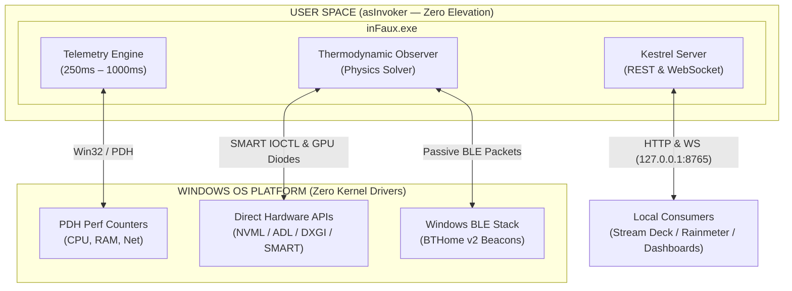

# inFaux Detailed Technical Specification

> **Specification Version:** 1.2.0  
> **Document Status:** Active Specification  
> **Repository:** [TalviFox/inFaux](https://github.com/TalviFox/inFaux)  
> **Companion Document:** [README.md](README.md)

---

## 1. System Architecture & Design Principles

### 1.1 Non-Elevated User-Mode Operation (`asInvoker`)
Traditional Windows hardware monitoring utilities rely on Ring-0 kernel drivers (such as `WinRing0.sys` or custom kernel modules) to interface directly with Model-Specific Registers (MSRs) and Super I/O chipsets. In modern Windows 10 and Windows 11 installations, these drivers frequently violate:
* **Hypervisor-Protected Code Integrity (HVCI) / Memory Integrity**
* **Microsoft Vulnerable Driver Blocklist**
* **Standard User Account Control (UAC) security policies**

`inFaux` operates strictly within the Windows user security context (`asInvoker`). The executable requires **zero elevation**, loads **zero kernel drivers**, installs **zero background services**, and triggers **zero UAC consent dialogs**. If launched with elevated administrative privileges, the application issues a visual notification reminding the user that elevation is neither required nor recommended.



### 1.2 Memory & Runtime Footprint
* **Runtime:** .NET 10.0 (Windows Desktop runtime, self-contained single-file publish).
* **RAM Footprint:** ~115 MB steady-state private working set.
* **Process Count:** Single process (`inFaux.exe`); zero helper daemons or telemetry collectors.
* **Single Instance Enforcement:** Named system mutex (`inFaux_SingleInstance_Mutex`) ensures one active instance per user session. Subsequent launches focus the active window or flash the system tray icon.

---

## 2. The Thermodynamic Observer

Because user-mode processes cannot directly poll the CPU digital thermal sensor (DTS) without kernel privileges, `inFaux` models processor thermodynamics through physical state estimation and ground-truth hardware diode anchoring.

### 2.1 Storage Diode Anchoring (Steady-State Chassis Floor)
Solid-state drives (NVMe and SATA) expose standard hardware diode telemetry through non-elevated Win32 storage IOCTLs (`IOCTL_STORAGE_QUERY_PROPERTY` with `dwDesiredAccess = 0`). Because SSD controller and NAND thermal mass are physically coupled to motherboard copper planes and internal chassis airflow, SSD temperatures provide a stable, load-independent ground-truth anchor ($T_{\text{chassis}}$):

$$T_{\text{ambient}} = \min(T_{\text{NVMe}}, T_{\text{SATA}}) - \Delta T_{\text{offset}}$$

> **In plain English:** Your SSD is bolted right to the motherboard in the chassis airflow. If your coldest idle drive sits at 36°C, case ambient intake air is typically around 28°C. We use that as a rock-solid baseline floor so CPU estimations don't float away.

This prevents circular dependencies where CPU load estimations skew the baseline ambient reference.

### 2.2 Direct Liquid Cooler (AIO) Radiator Loop Alignment
When a liquid cooling profile (`AIO`) is active and paired with a radiator exhaust probe (via BTHome v2 Bluetooth telemetry):
* The coolant temperature ($T_{\text{coolant}}$) is anchored directly to measured radiator exhaust airflow.
* Thermal resistance between CPU die, solder thermal interface material (STIM), and the copper cold plate is accounted for:
  $$\theta_{\text{coldplate}} \approx 0.08\,\text{K/W to } 0.14\,\text{K/W}$$
* Under prolonged all-core workloads (e.g. Core i9-14900K, Ryzen 9 7950X), coolant heat soaking is simulated, preventing the cold plate from dissipating heat faster than the physical radiator fluid loop allows.

> **In plain English:** Liquid coolers don't stay ice cold forever. As fluid absorbs heat over 10 minutes of heavy rendering, the baseline rises. If a Bluetooth sensor measures warm exhaust coming off your radiator, inFaux reflects that heat soak on the CPU die.

### 2.3 Copper Integrated Heat Spreader (IHS) Simulation
The thermal mass of the processor package (silicon die, STIM, and nickel-plated copper heat spreader) is solved using an asymmetric first-order Infinite Impulse Response (IIR) low-pass filter:

$$T_{\text{IHS}}[n] = T_{\text{IHS}}[n-1] + \alpha \cdot \left( T_{\text{target}}[n] - T_{\text{IHS}}[n-1] \right)$$

where the smoothing coefficient $\alpha$ is dynamic based on thermal flux direction:
* **Rapid Thermal Inrush ($\Delta T > 0$):**
  $$\tau_{\text{rise}} = 1.8\,\text{seconds} \quad \implies \quad \alpha_{\text{rise}} = 1 - e^{-\Delta t / \tau_{\text{rise}}}$$
* **Gradual Radiative Dissipation ($\Delta T < 0$):**
  $$\tau_{\text{fall}} = 3.5\,\text{seconds} \quad \implies \quad \alpha_{\text{fall}} = 1 - e^{-\Delta t / \tau_{\text{fall}}}$$

> **In plain English:** Silicon heats up instantly when you click render, but copper and water hold onto heat. The filter responds quickly to sudden load surges ($\tau = 1.8\text{s}$), but lets the cooler bleed off stored energy more gradually when the load drops ($\tau = 3.5\text{s}$).

This accurately replicates physical copper heat conduction: silicon heats up near-instantaneously under surge loads, while the cold plate and fin stack dissipate stored thermal energy gradually.

### 2.4 CMOS Dynamic Joule Power Extrapolation
Package wattage is derived in real-time by combining hardware TDP baselines with per-core clock frequency scaling and utilization:

$$P_{\text{dynamic}} = P_{\text{idle}} + \sum_{i=1}^{N_{\text{cores}}} \left( \frac{f_i}{f_{\text{base}}} \right)^2 \cdot U_i \cdot \frac{\text{TDP}}{N_{\text{cores}}}$$

Where:
* $f_i$ is the instantaneous frequency of core $i$ sampled via Performance Data Helper (PDH) performance counters.
* $U_i \in [0, 1]$ is the utilization percentage of core $i$.
* $\text{TDP}$ is the processor thermal design power (auto-detected or overridden in settings).

> **In plain English:** User mode can't read core voltage without a kernel driver. But since voltage increases alongside clock speed on modern boost algorithms, squaring the boost ratio $\left(\frac{f}{f_{\text{base}}}\right)^2$ acts as a clean stand-in for the missing voltage telemetry, capturing the non-linear power surge of turbo clocks.

### 2.5 Localized Per-Core Thermal Flux Modeling
Individual cores and compute clusters (e.g., AMD Zen CCX / CCD or Intel P-Core / E-Core clusters) exhibit non-uniform temperature gradients during asymmetric workloads. `inFaux` distributes thermal bloat across the package matrix:
* Cores sustaining boost frequencies ($f_i > f_{\text{base}}$) at high loads receive localized positive thermal deltas (+4°C to +18°C above IHS base).
* Idle cores adjacent to loaded clusters reflect conductive bleed while idle isolated cores remain near the cold plate floor.

### 2.6 Thermodynamic Boundary Clamps
Physical boundary clamps ensure thermal metrics remain within physically possible bounds:
* **Cooling Floor Clamp:** $T_{\text{CPU}} \ge T_{\text{ambient}}$ (the CPU cannot read cooler than the air or liquid cooling it).
* **Radiator Delta Clamp:** For liquid-cooled systems, $T_{\text{die}} \ge T_{\text{radiator\_exhaust}} + \Delta T_{\text{TIM\_minimum}}$.
* **Honest Telemetry Tagging:** Every metric emitted via UI, Tray, and API is tagged:
  * `[Measured]` -  Direct diode readings (GPU core, GPU hotspot, NVMe drive, BLE thermometers).
  * `[Estimated]` -  Solved thermodynamic observer values (CPU package, individual core temperatures).

---

## 3. Hardware Harvesters & Subsystems

### 3.1 Processor (CPU)
* **Performance Counter Queries:** Utilizes Windows PDH (`PdhOpenQuery`, `PdhAddEnglishCounterW`) against `\Processor Information(0,*)\% Processor Performance` to harvest hardware-level core frequencies without driver intervention.
* **Workload Utilization:** Native Win32 `GetSystemTimes` provides lightweight kernel/user/idle time deltas with sub-millisecond overhead.
* **Topology Detection:** WMI and SMBIOS detect core architecture, physical sockets, hyperthreading/SMT threads, and cache hierarchy.

### 3.2 Graphics (GPU & APU)
* **NVIDIA NVML (`nvml.dll`):** Direct dynamically-loaded interop with the vendor driver library in `System32`. Queries core clocks, memory clocks, board power (W), fan speeds, VRAM allocation, and physical core/hotspot diode temperatures.
* **AMD ADL (`atiadlxx.dll`):** Interop with AMD Display Library for Overdrive clock states, board wattage, and diode temperatures.
* **DirectX DXGI COM Interop (`IDXGIFactory1`, `IDXGIAdapter3`):** Zero-driver hardware enumeration, dedicated VRAM queries, and shared system memory usage.
* **Integrated APU / iGPU Classification:**
  * Adapters without discrete VRAM are tagged `IsDiscrete = false`.
  * Telemetry suppresses discrete-only metrics (hotspot, fan RPM).
  * APU power is modeled as a dynamic load-weighted slice (10% to 55%) of the SoC package power.
* **Hardware Label Sanitization & Aliasing:** Strips driver marketing noise (`(R)`, `(TM)`, `Corporation`) and allows user-defined custom aliases synchronized across UI, API, and Stream Deck.

### 3.3 Storage (NVMe & SATA)
* **Drive Geometry & Capacities:** Queried via Win32 `GetDiskFreeSpaceEx` and `DriveInfo`.
* **Throughput Rates:** Real-time disk read/write throughput (MB/s) tracked via PDH `\PhysicalDisk(*)\Disk Read Bytes/sec` and `Disk Write Bytes/sec`.
* **SMART Telemetry:** Standard non-elevated user-mode IOCTL calls (`IOCTL_STORAGE_QUERY_PROPERTY`) retrieve controller temperature, media type (SSD/HDD), bus type (NVMe/SATA/USB), and drive health status.

### 3.4 System Memory (RAM)
* **Global Allocation:** Polled via Win32 `GlobalMemoryStatusEx` for physical memory load %, used/available GB, and committed virtual memory.
* **Module Hardware Details:** SMBIOS queries extract physical DIMM count, manufacturer, part numbers, channel configuration, and configured frequency (MT/s).
* **Pool Telemetry:** Non-paged pool and paged pool allocations are monitored to catch driver memory leaks.

### 3.5 Network & Power / UPS
* **Network Throughput:** Uses `GetIfTable2` / PDH network counters to calculate real-time download/upload rates (Mbps) and link speed. Automatic adapter switching targets the active interface with the highest traffic volume.
* **Battery & UPS:** Calls Win32 `GetSystemPowerStatus` to track AC line status, battery percentage, and remaining runtime. Automatically detects USB-connected uninterruptible power supplies (UPS) on desktop workstations.

### 3.6 Wireless Bluetooth Environmental Telemetry (BTHome v2)
* **Passive BLE Advertisement Watcher:** Leverages the native Windows Runtime Bluetooth API (`Windows.Devices.Bluetooth.Advertisement.BluetoothLEAdvertisementWatcher`) to passively listen for unencrypted standard BLE beacon packets.
* **No Pairing Required:** Functions continuously without pairing, PIN codes, USB dongles, or companion software.
* **Supported Devices:**
  * Shelly BLU H&T (native out-of-the-box BTHome v2)
  * ThermoBeacon / Qingping beacons
  * Custom ESP32 / ESPHome / Arduino sensor nodes
  * Xiaomi / Tuya thermometers running open BTHome v2 firmware
* **Natural Airflow Modeling:**
  $$\mathbf{Room} \;\longrightarrow\; \mathbf{Case} \;\longrightarrow\; \mathbf{Exhaust}$$
  Automatically upgrades estimated room or chassis calculations to real physical measured diode data when sensors are detected.

---

## 4. Stream Deck Companion Integration

`inFaux` includes an integrated, zero-configuration Elgato Stream Deck plugin located in `integrations/streamdeck/` and packaged as `com.foxden.infaux.streamDeckPlugin`.

### 4.1 In-App Lifecycle Management
* **1-Click Installation:** Directly extracts and registers the plugin into `%APPDATA%\Elgato\StreamDeck\Plugins\` without requiring manual file copying or marketplace accounts.
* **Automatic Version Sync:** Detects existing installations and provides in-app upgrade and clean uninstallation buttons within the Settings view.

### 4.2 Dynamic Canvas Rendering
* Keys render at 144x144 pixel resolution via HTML5 Canvas / SVG vector rendering.
* Displays real-time hardware gauges for **CPU**, **GPU**, **RAM**, **Network**, and **BT Sensor** with progress arcs, metric units, and status badges.
* **Theme Modes:**
  * *Monochrome:* Clean high-contrast white on dark slate.
  * *Theme Accent:* Synchronizes with the active Fox Coat palette.
  * *Reactive:* Real-time thermal grading (Green `< 65°C`, Amber `65°C - 79°C`, Red `≥ 80°C`).

### 4.3 Property Inspector & Interactive Tap
* **Dynamic Key Renaming:** Allows custom text headers (e.g. `RTX 4090`, `OFFICE`, `DESK`) directly from the Property Inspector without obscuring numeric metrics.
* **Interactive Quick Tap:**
  * *GPU / Net:* Tap the key to cycle between multiple physical adapters.
  * *BT Sensor:* Tap to toggle instantly between Temperature and Humidity readings.

---

## 5. Dynamic Numeric System Tray Engine

The system tray engine generates real-time numeric temperature badges rendered directly onto the Windows taskbar icon area.

* **Pixel Buffer Generation:** Live GDI+ 16x16 / 32x32 dynamic bitmaps rendered per polling cycle.
* **Theme Reactivity:** Matches foreground and background colors of the active Fox Coat theme.
* **Escalation Colors:**
  * Nominal (`< 65°C`): Theme accent color
  * Warning (`65°C - 79°C`): Safety Amber (`#F59E0B`)
  * Critical (`≥ 80°C`): Hot Alert Red (`#EF4444`)
* **Sensor Selection:** Right-click context menu enables switching target telemetry between:
  * `cpu_temp` (CPU Package Temperature)
  * `gpu_temp` (Primary Discrete GPU Core Temperature)
  * `auto_max_temp` (Highest of CPU or GPU)

---

## 6. Embedded Local API Reference

The telemetry server embeds an ASP.NET Core Kestrel instance running on `http://127.0.0.1:8765`. By default, the server binds strictly to the local loopback interface for security.

### 6.1 Endpoints Overview

| Method | Endpoint | Description |
| :--- | :--- | :--- |
| `GET` | `/` | Root manifest, version, and documentation index |
| `GET` | `/api/v1/summary` | Curated JSON snapshot of all system telemetry |
| `GET` | `/api/v1/sensors` | Flat array of all registered sensors with min/max tracking |
| `GET` | `/api/v1/sensors/{category}` | Category-filtered sensors (`cpu`, `gpu`, `memory`, `storage`, `network`) |
| `GET` | `/api/v1/history/{metricId}` | 60-second rolling ring buffer for sparklines |
| `GET` | `/api/v1/health` | Service health status, uptime, and poll cycle latency |
| `WS` | `/api/v1/stream` | Full-duplex WebSocket streaming live telemetry frames |

### 6.2 Curated Telemetry Snapshot (`GET /api/v1/summary`)
```json
{
  "timestamp": "2026-10-12T15:00:00Z",
  "cpu": {
    "name": "AMD Ryzen 7 PRO 7840U w/ Radeon 780M Graphics",
    "tempC": 39.5,
    "loadPercent": 14.8,
    "powerWatts": 18.2,
    "clockGhz": 3.30,
    "coreCount": 8,
    "cores": [
      { "name": "Core 0", "tempC": 39.2, "clockMhz": 3294, "loadPercent": 12.0 },
      { "name": "Core 1", "tempC": 40.1, "clockMhz": 3410, "loadPercent": 18.5 }
    ]
  },
  "gpu": {
    "name": "AMD Radeon 780M Graphics",
    "isDiscrete": false,
    "vendor": "AMD",
    "tempC": 39.5,
    "hotspotTempC": null,
    "loadPercent": 0.0,
    "powerWatts": 1.8,
    "vramUsedGb": 0.35,
    "vramTotalGb": 3.91,
    "fanRpm": null
  },
  "memory": {
    "usedGb": 14.3,
    "totalGb": 28.0,
    "percent": 51.0,
    "availableGb": 13.7,
    "speedMts": 6400
  },
  "storage": [
    {
      "name": "Micron 2400 MTFDKBA1T0QFM",
      "driveLetter": "C:",
      "tempC": 36.0,
      "healthPercent": 100.0,
      "healthStatus": "Healthy (OK)",
      "busType": "NVMe",
      "mediaType": "Solid State Drive (SSD)",
      "usedGb": 412.5,
      "totalGb": 953.8,
      "readSpeedMBps": 1.2,
      "writeSpeedMBps": 0.4
    }
  ],
  "network": {
    "adapterName": "Wi-Fi",
    "adapterDescription": "Intel(R) Wi-Fi 6E AX210 160MHz",
    "downloadMbps": 4.82,
    "uploadMbps": 0.65
  },
  "chassis": {
    "chassisAirTempC": 36.8,
    "chassisAirTempF": 98.2,
    "estimatedAmbientTempC": 22.4,
    "estimatedAmbientTempF": 72.3,
    "thermalResistanceCPerW": 0.35,
    "confidencePercent": 85
  }
}
```

### 6.3 WebSocket Live Telemetry (`WS /api/v1/stream`)
Clients connecting to `/api/v1/stream` receive real-time JSON frames on every engine polling cycle (default: 1000ms). The payload matches the `SystemSummary` data contract.

---

## 7. Configuration Reference

Application settings are persisted to `%LOCALAPPDATA%\inFaux\config.json`. Modifications made via the UI Settings tab are atomically saved.

| Key | Type | Default | Description |
| :--- | :--- | :--- | :--- |
| `apiPort` | `int` | `8765` | Port for the embedded REST and WebSocket server |
| `enableApi` | `bool` | `true` | Enables or disables the embedded HTTP/WebSocket API |
| `apiBindLocalhostOnly` | `bool` | `true` | When true, binds only to loopback (`127.0.0.1`) |
| `pollingIntervalMs` | `int` | `1000` | Telemetry harvest interval in milliseconds (250ms to 2000ms) |
| `traySensorTarget` | `string` | `"cpu_temp"` | Tray badge metric: `"cpu_temp"`, `"gpu_temp"`, or `"auto_max_temp"` |
| `preferredNetworkAdapter` | `string` | `"Auto"` | Interface to monitor: `"Auto"` (highest traffic) or specific adapter name |
| `chassisProfile` | `string` | `"Auto"` | Enclosure profile for air cavity modeling: `"Auto"`, `"Laptop"`, `"Desktop"` |
| `coolerProfile` | `string` | `"Auto"` | Thermal dissipation scaling: `"Auto"`, `"AIO"`, `"TowerAir"`, `"Compact"` |
| `cpuThermalOffset` | `double` | `0.0` | Live calibration offset in °C (-15.0 to +15.0) |
| `cpuTdpOverrideWatts` | `int` | `0` | Package TDP target for Joule heating (0 = auto-detect) |
| `gpuNameAliases` | `object` | `{}` | Custom hardware labels and GPU name overrides keyed by ID or description |
| `trayDisplayBadge` | `bool` | `true` | Toggle rendering the live numeric temperature badge on the tray icon |
| `startWithWindows` | `bool` | `true` | Start on user logon via Windows Task Scheduler (0 UAC prompts) |
| `checkForUpdates` | `bool` | `true` | Automatic GitHub release auditor check |

---

## 8. Build, Release & Verification Pipeline

### 8.1 Build Prerequisites
* Windows 10 (Build 19041+) or Windows 11
* [.NET 10.0 SDK](https://dotnet.microsoft.com/)

### 8.2 Compilation Commands
```powershell
# Standard Debug build
dotnet build -c Debug

# Single-file self-contained Release publish
dotnet publish InFox.csproj -c Release -r win-x64 --self-contained true -p:PublishSingleFile=true -o publish
```

### 8.3 Release Automation (`release.ps1`)
The automated release script builds the single-file binary, calculates cryptographic hashes, and stages release artifacts:
```powershell
.\release.ps1 -Version "1.2.0" -SkipGit
```

Outputs produced in `publish/`:
* `inFaux.exe` (Self-contained executable)
* `SHA256SUMS.txt` (Full hash manifest)
* `inFaux.exe.sha256` (Single hash file)

### 8.4 Cryptographic Verification (`verify.ps1`)
Users can verify their local binary against official published GitHub Release checksums:
```powershell
.\verify.ps1
```

---

*Copyright © FoxDen Software. Distributed under the PolyForm Noncommercial License 1.0.0.*
